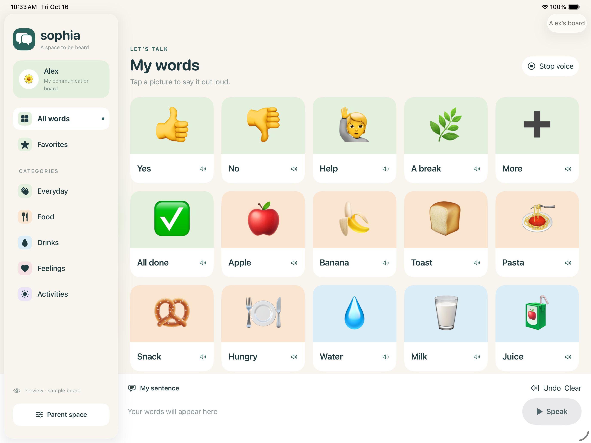

# Sophia-AAC

**An iPad picture communication app for autistic children.** Parents create personal boards with familiar photos and everyday words. Children tap a picture to speak using Apple's built-in voices.

Sophia is being rebuilt in SwiftUI for **iPad only**, with offline storage and private iCloud sync through the parent's Apple Account. No separate Sophia account or Rails backend is required.

## Development status

The native app builds, passes ten data tests and two UI tests, and is installed and launching on a development iPad. Hands-on testing of speech, personal boards, and cross-device iCloud sync is underway. **There is no public App Store or TestFlight release yet.**

See [validation results and remaining checks](Docs/VALIDATION.md).

## What you can do

- Create separate child profiles with their own photos and communication boards.
- Organize large picture cards into categories and favorites.
- Tap a card to speak, or collect words in a sentence strip with Speak, Undo, Clear, and Stop voice controls.
- Start with 27 words across Everyday, Food, Drinks, Feelings, and Activities, then personalize them.
- Choose from 120 bundled pictures. Enter a card label for matching suggestions, or search the full library by name or tag. Parents confirm the picture; suggestions never replace an image or rewrite spoken words automatically.
- Keep a personal photo instead when it better represents the message. Library pictures work offline and are stored once in the app, not copied into every card.
- Use a separate parent space to edit profiles, categories, pictures, labels, spoken phrases, favorites, and ordering.
- Choose English or Arabic speech voices and adjust speaking speed. Changing a voice does not translate card content.
- Save boards offline, with a separate build configuration for private CloudKit sync across iPads using the same Apple Account.
- Export a separate JSON backup and restore it as a new profile without overwriting an existing board.

Starter content is optional and customizable. The parent check discourages accidental editing; it is not a password lock. Download any required voices to the iPad before relying on offline speech.

## Open and run

Requires **iPadOS 17 or later** and Xcode with the iOS SDK. The target supports iPad, not iPhone or Mac Catalyst.

1. Clone the repository and open **Sophia-AAC.xcodeproj**.
2. Choose the **Sophia-AAC** scheme and an iPad simulator, then Run. This scheme saves locally without iCloud configuration.
3. Create a profile and leave **Include starter words** on to try the sample board.
4. For an in-memory sample preview, add `--demo` under Edit Scheme → Run → Arguments. Remove it for normal use; demo changes reset on launch and never sync.

For private iCloud sync, choose **Sophia-AAC iCloud**, configure your own Apple Developer team and CloudKit container, then run on a signed-in iPad. Copy `Configuration/Signing.example.xcconfig` to the ignored `Configuration/Signing.local.xcconfig` for your identifiers. No passwords, certificates, or speech API keys belong in the repository.

Full instructions: [setup, signing, iCloud, backups, and tests](Docs/SETUP.md).

## Storage and privacy

The native app uses SwiftData on the iPad and, in the iCloud build, the parent's private CloudKit database. There is no Sophia login, third-party speech service, advertising, or analytics SDK.

CloudKit sync is eventual and carries edits and deletions between devices; it is not an independent backup. Export a separate backup when needed. Exported files include profile names and photos, so keep them private.

## Built with

SwiftUI · SwiftData · CloudKit · AVFoundation · PhotosUI. No third-party packages are required.

## Source layout

| Path | Purpose |
| --- | --- |
| `Sources/` | Native app, models, speech, parent editors, and backups |
| `Assets.xcassets/` | App icon and bundled starter pictures |
| `Configuration/` | Local/iCloud build settings, entitlements, and privacy manifest |
| `Tests/`, `UITests/` | Data and iPad interaction tests |
| `Scripts/` | Project/asset generation and release guard |
| `Docs/` | Setup, validation, release checklist, and preview |
| `legacy/rails/` | Temporary reference copy of the original web app |

## Before release

**Remove the entire `legacy/` directory before going live.** Release builds fail while it exists. Rails files are never included in the iPad target, and no existing-user migration is planned. Removing legacy files from the current tree does not erase Git history.

Finish device and iCloud verification, CloudKit production schema setup, and distribution preparation using the [release checklist](Docs/RELEASE.md).
